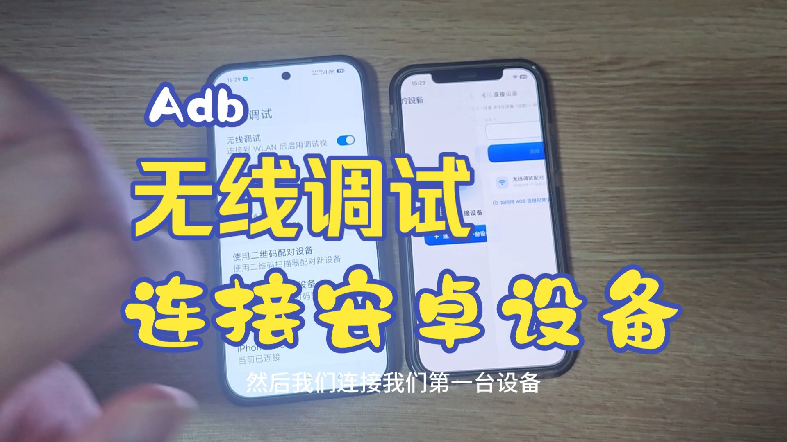
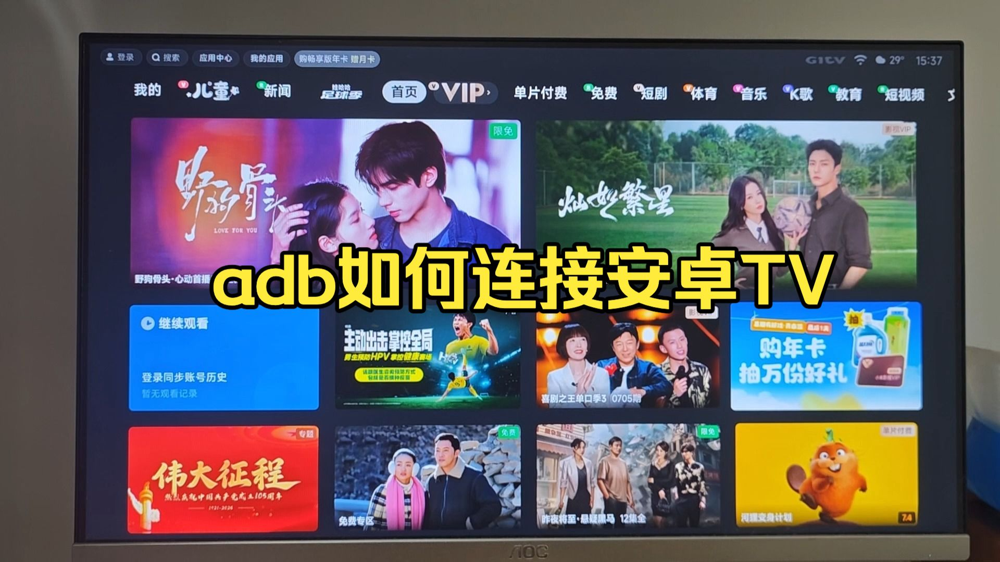

# 如何用 ADBox 连接 adb 与常见问题

## 视频教程

点击封面或平台链接观看视频。GitHub 文档页不内嵌播放视频。

### adb 无线调试连接 android11+ 设备

[Bilibili](https://www.bilibili.com/video/BV1ZET16GEhB/) · [YouTube](https://www.youtube.com/watch?v=TMlN1gav29w)

### adb 连接 Android TV

[Bilibili](https://www.bilibili.com/video/BV1cgT16UEt1/) · [YouTube](https://www.youtube.com/watch?v=X3JGCyyR2jw)

## 连接前提

手机与电视处于**同一局域网（同一 Wi-Fi）**，电视已开启「网络调试 / ADB 调试」，且允许本机调试；路由器未开启「AP 隔离 / 访客网络隔离」。

| 端口 | 用途 |
| --- | --- |
| `5555` | ADB 网络调试端口，首次握手授权与装插件走它 |

## 电视 / 机顶盒 ADB 开启方式

不同厂商入口不同，在电视端按下表开启 **ADB 网络调试**（无线调试，非 USB 调试）：

| 厂商 | 开启路径（参考） |
| --- | --- |
| 通用 Google TV | 设置 → 系统 → 关于 → 版本号连点 7 次 → 开发者选项 → 打开「USB 调试」与「无线调试」 |
| 小米 / 红米 | 设置 → 关于 → 产品型号按 OK 键 6–8 次 → 账号与安全 → ADB 调试 |
| 海信 / Vidda | 我的应用 → VIDDA 助手 → 电视调试授权（或开发者模式） |
| TCL / 雷鸟 | 设置 → 系统 → 系统信息 → 遥控器上下左右 → 打开网络调试 |
| 创维 / 酷开 | 设置 → 本机信息 → 遥控器上上下下左右左右 → 开启 ADB |
| 长虹 / 康佳 / OPPO / 索尼 | 进工厂菜单或开发者模式后打开网络 ADB |
| 天猫魔盒 | 进入「系统设置」页面 → 遥控器按「下→右→左→上→下→右→左→上」→ 开启 ADB 调试 |
| 华为 / 荣耀（鸿蒙） | 鸿蒙系统用 hdc 而非标准 ADB，部分机型出厂禁用 TCP 调试，不一定支持 |

电视端开启调试后，记下电视的 **IP 地址**（在电视「网络设置」里查看），下一步在手机上要用到。

## 手机 ADB 连接方式

### 首次连接（完整流程）

1. 手机打开应用，首页点「新建」，输入电视 **IP 地址** 与端口（默认 `5555`），点「连接」。
2. **建立连接**：通过 ADB 握手连接电视。首次连接时电视会弹授权窗口，请在电视上勾选「一律允许」并确定。
3. **安装加速插件**：应用把内置插件 APK 发送到电视并安装，界面显示实时进度。
4. **准备就绪**：插件启动、快速通道就绪，自动进入操作页；设备同时保存到首页列表。

### 再次连接（快速通道）

1. 首页点击已保存的电视设备。
2. 应用自动检测设备状态；命中快速通道且插件版本一致 → **直接进操作页，无需重新授权或重装插件**。
3. 若快速通道未命中（电视休眠 / IP 变化等）→ 自动降级到 ADB 完整流程，授权仍有效时会自动重连。

### 修改已保存设备

首页长按设备 → 编辑面板可改名称、IP、端口 → 保存后按新地址重连。

**端口不通**（提示「无法访问 ADB 端口」）会引导你去开启电视调试；**授权被拒**则留在连接页提醒你在电视上同意授权——别把这两种情况搞混。

## 常见问题

多数失败来自三类：电视未开调试、不在同一局域网、IP 变了。先按下面逐项排查。

### 连不上电视 / 提示无法访问 ADB 端口？

1. 确认电视已开「网络调试 / ADB 调试」（见上文厂商表）。
2. 确认手机与电视在**同一 Wi-Fi / 局域网**，且路由器未开「AP 隔离 / 访客网络隔离」。
3. 确认 IP 没变（电视重启或重连 Wi-Fi 后 IP 可能变化），在电视网络设置里重新查看。
4. 端口默认 `5555`，部分机顶盒需手动改为对应端口。

### 电视没弹授权窗口 / 点了拒绝怎么办？

授权窗口在**首次连接**时出现。若没弹出，断开后重连一次；弹出后请勾选「一律允许」再确定。误点拒绝会停留在连接页，重连后会再次弹窗。授权一旦通过，本机令牌持久保存，之后不再弹。

### 为什么第一次连接比较慢？

首次需通过 ADB 把加速插件装到电视上（含下载、安装、拉起服务）。装好后再次连接走快速通道，秒级直进，无需重装。

### 之前能连，现在连不上了？

- 电视休眠或重启 → 唤醒电视后重连，应用会自动降级到 ADB 流程恢复。
- IP 地址变了 → 首页长按设备，编辑成新 IP 后重连。
- 电视端调试被关闭 / 撤销授权 → 重新开启调试并在电视上重新授权。

### 支持华为 / 荣耀（鸿蒙）电视吗？

鸿蒙系统使用 hdc 而非标准 ADB，部分机型出厂禁用 TCP 调试，**不一定支持**。建议先确认机型是否可开启网络 ADB 调试。

### 支持 USB 连接吗？

本应用为**网络（无线）ADB 连接**，通过电视 IP 连接，不走 USB 数据线。

### 会上传我的数据 / 联网吗？

本应用是**本地纯客户端、无后端**，不联网上报、不接广告或第三方统计。所有操作直接在手机与电视之间进行。
